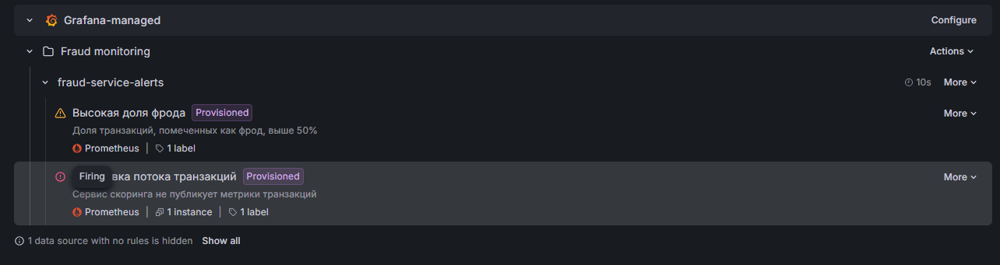

# Мониторинг потокового антифрода

Сдалено на основе кода с семинара. Читаем транзакции из Kafka, считаем score и fraud flag, сохраняем результаты в PostgreSQL и показываем состояние потока в Prometheus/Grafana. 

Добавлены алерты, разрезы по версии модели и бизнес-показатели.

## Запуск

```bash
cp .env.example .env
```

В `.env` укажите `TRAIN_DATA_CSV` на `train.csv`. Например `TRAIN_DATA_CSV=./data/train.csv`.

```bash
docker compose up --build
```

Остановить систему и удалить сохраненные данные и состояние Grafana:
```bash
docker compose down -v`
```

## Куда смотреть

| Сервис | Адрес |
|---|---|
| Grafana | http://localhost:3000 (`admin` / `admin`)
| Prometheus | http://localhost:9090 |
| Метрики скорера | http://localhost:8000/metrics |
| Метрики записи в БД | http://localhost:8001/metrics |
| Kafka UI | http://localhost:8080 |
| Airflow | http://localhost:8081 а(`admin` / `admin`)|

В Grafana откройте **Dashboards**:

- **Fraud Detection Dashboard** — скорость обработки, среднее время, доля фрода, распределение score и ошибки обработки. Здесь же появляется краткая отметка о переключении модели.
- **Scoring Dashboard** — скорость и время записи в БД, число выявленных фродовых транзакций и распределение записанных score.
- **Node Metrics** — CPU, память, сеть и дисковый ввод-вывод.
- **Fraud Business Analysis** — количество и доля фрода по версии модели. TPS и гистограмма score с фильтрами `US state` и `Merch`. доля фрода по категориям `cat_id` в последних 1000 записях. средняя сумма фродовых транзакций.

Источники Prometheus и PostgreSQL, дашборды и алерты загружаются автоматически из `grafana/provisioning/` и `grafana/dashboards/`.

## Как проверить поток и метрики

1. В Prometheus откройте **Status → Targets**. Цели `fraud_detector`, `scoring_writer` и `node` должны иметь состояние **UP**.
2. На `http://localhost:8000/metrics` найдите `transactions_total`. Счетчик должен расти при работающем потоке. на Fraud Detection Dashboard должен появиться ненулевой TPS.
3. Проверьте `http://localhost:8001/metrics`: `scorings_total` растет вместе с записью результатов. В Kafka UI можно наблюдать топики `transactions` и `scoring`.
4. В Grafana откройте **Alerting → Alert rules**: там должны быть provisioned правила **Высокая доля фрода** и **Остановка потока транзакций**.

Чтобы проверить алерт остановки потока, выполните:

```bash
docker compose stop transaction_simulator
```

После окна проверки правило **Остановка потока транзакций** перейдет в `Firing`. Возобновите поток:

```bash
docker compose start transaction_simulator
```

Алерт высокой доли фрода срабатывает, если `fraud_ratio` остается выше 0.5 в течение 30 секунд. Состояние правил проверяется в Grafana.



## Проверка смены модели

В Airflow откройте DAG `retrain_catboost` и нажмите **Trigger DAG**. После публикации новой модели скорер подхватит ее при следующей обработанной транзакции, без перезапуска контейнера.

- на **Fraud Detection Dashboard** появилась annotation с версией модели.
- в таблице **Объем и доля фрода по версии модели** на **Fraud Business Analysis** появилась новая версия.

## Что реализовано

- Prometheus собирает метрики скорера, writer и Node Exporter каждую секунду.
- Скорер экспортирует `transactions_total`, `transaction_processing_seconds`, `fraud_score`, `fraud_ratio`, `model_version_updates_total` и `transaction_processing_failures_total`. Последняя метрика показывает число ошибок обработки и отображается на Fraud Detection Dashboard.
- Writer экспортирует `scorings_total`, `scoring_db_write_seconds`, `fraud_detected_total` и `scoring_fraud_score`.
- Writer сохраняет в `scores` версию модели и поля `us_state`, `merch`, `cat_id`, `amount`, нужные для SQL-дашборда. Схема создается/обновляется автоматически при запуске.
- Алерты и все источники/дашборды provisioned, ручная настройка Grafana не требуется.
